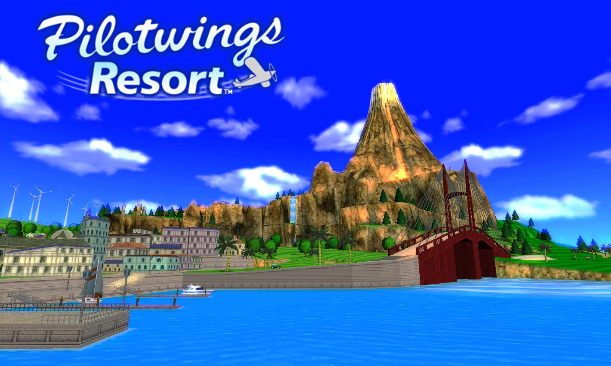
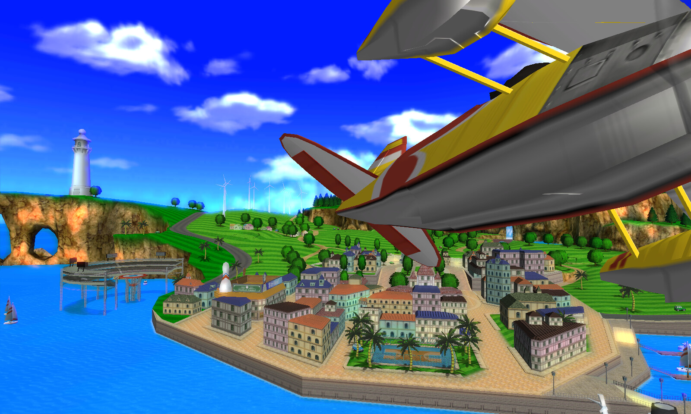
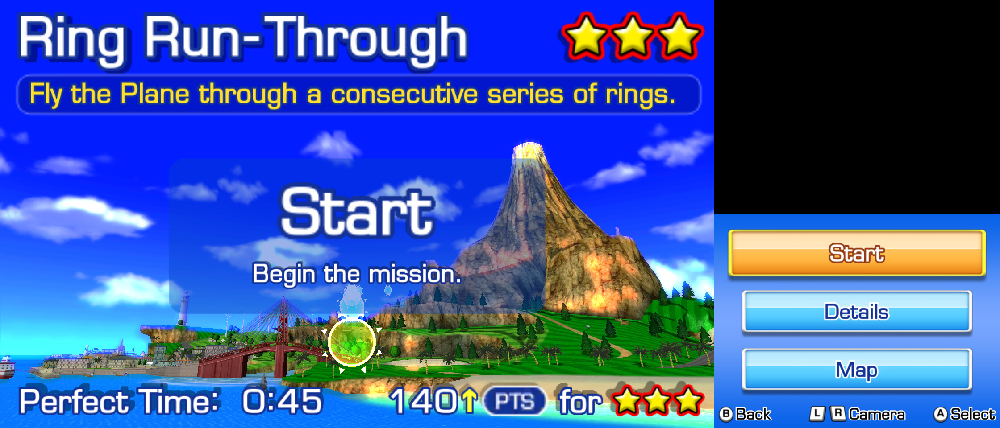
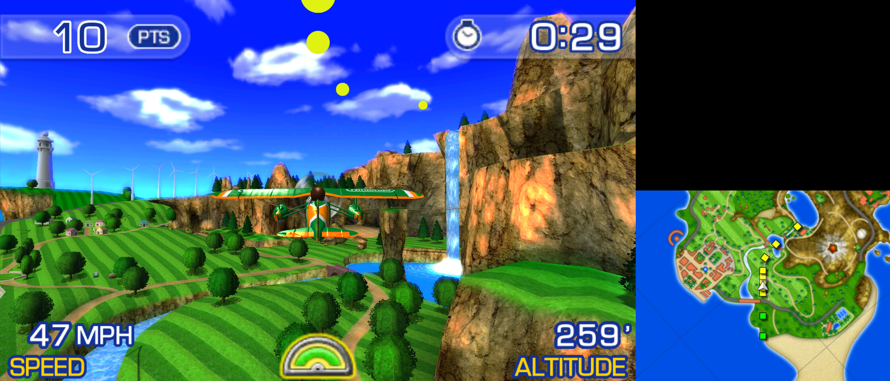

# Woohoo! Flight School

Play your own copy of *Pilotwings Resort* (3DS, USA) as a native PC program. The tools here translate the game's code
from your dump into C (static recompilation), build it with your compiler, and run it. Nothing from the game is
included in this repository. How it works: [docs/architecture.md](docs/architecture.md).



| | |
|---|---|
|  |  |



*Screenshots: 4x 3D resolution, 16x anisotropic filtering, sharp bilinear scaling, large screen layout.*

> **Disclaimer.** Woohoo! Flight School is an unofficial fan project. It is not affiliated with, endorsed or sponsored by Nintendo or
> Monster Games. *Pilotwings*, *Pilotwings Resort*, *Nintendo 3DS* and *Mii* are trademarks of Nintendo. The
> repository contains no game code, graphics, sound or other game data and no decryption keys. You need your own,
> legally obtained copy of the game, dumped from your own console. Please don't ask for ROMs or built binaries: a
> built `pwr` contains code translated from the game and must not be shared.

## Status

**Works:** the title intro, Mii sign-up, the trial flights with all three vehicles (plane, rocket belt, hang glider),
Mission Flight and Free Flight as far as they have been played, saving, sound, keyboard, mouse and gamepad. Tested on
Linux and Windows, at 60 fps, also at 4x resolution.

Added for the PC (all optional, see [Display settings](#display-settings)):
- 3D resolution up to 4x;
- anisotropic filtering;
- AMD FSR 1, FXAA and sharp bilinear scaling;
- screen layouts, including one that switches automatically between menus and flight;
- longer draw distance;
- free look on the right stick;
- a settings overlay (F1).

**Known issues and limits:**
- The whole game has not been played through yet. Later missions may still hit untested code; please report crashes
  with the terminal output.
- Building on Windows itself (the build kit or MSYS2) is newer than the Windows port: it has been tested under Wine and
  by GitHub Actions so far. Reports from Windows players are welcome.
- No macOS build.
- Touch-screen input needs the mouse, also when you play with a gamepad (the signature at sign-up, some menus).
- No stereoscopic 3D: the game is shown in 2D.
- Free look knows where the sea is, but not the island's ground: flying low over land, the camera can go through a
  hillside.
- The first run of a scene compiles shaders, which can cause a short hitch. They are kept for the next run.

## What you need

- A decrypted dump of **Pilotwings Resort (USA)**, title `0004000000031C00`, as `.cia`, `.3ds`/`.cci` or `.cxi`.
  Encrypted dumps are refused.
- Linux on x86-64, or Windows 10/11 on x86-64 (see [Windows](#windows)).
- A GPU with Vulkan 1.3 and the build tools:
  - Python 3.8+ with Tk (`python3-tk`);
  - CMake 3.16+;
  - GCC or Clang;
  - `glslc` (shaderc or the Vulkan SDK);
  - SDL2 and Vulkan development files;
  - optionally Ninja.

  On Debian/Ubuntu: `sudo apt install python3-tk cmake gcc ninja-build glslc libsdl2-dev libvulkan-dev`.

## Quick start

**Easiest on Linux: the build kit AppImage.** Download `WoohooFlightSchool-Linux-kit-x86_64.AppImage` from the
[latest release](https://github.com/thefixinhixon/woohoo-flight-school/releases), make it executable and start it
(`chmod +x WoohooFlightSchool-Linux-kit-x86_64.AppImage`, then double-click it or run it). It holds the launcher, Python,
a C compiler and the build tools (about 140 MB), so you only need a Vulkan driver and SDL2, which most desktop and gaming
systems already have (glibc 2.29 or newer: Ubuntu 20.04+, Debian 11+, Fedora, Arch, SteamOS). The game it builds goes to
the same install folder as below. Windows players: see [Windows](#windows).

**From the source** (with the build tools listed above):

```bash
python3 launcher/pwr_launcher.py
```

1. **Game ROM:** Browse to your dump. It is verified straight away (title, encryption, game-code hash).
2. **Build:** recompiles and compiles into the install folder (default `~/.local/share/pwr-port`). One to two minutes on a
   multi-core machine.
3. **Play:** pick or create a profile (each has its own saves and settings), adjust the display settings, Launch.

Without the GUI:

```bash
python3 tools/pipeline.py check                      # build tools present?
python3 tools/pipeline.py verify "My Dump.cia"
python3 tools/pipeline.py build "My Dump.cia"
python3 tools/pipeline.py run --profile default
python3 tools/pipeline.py profiles create alice
```

## Saving

The game saves nothing during the first trial flights. To keep your pilot, end the trial-flight period: pause, choose
**Return to Office**, answer **No** to trying another aircraft and **Yes** to ending the trial-flight period. The
instructor then explains the save icon and your profile is saved. If you quit before that, you sign up again next time,
as on the console.

Saves and settings belong to the launcher profile:

| | Linux | Windows |
|---|---|---|
| Save data | `~/.local/share/pwr-port/profiles/<name>/save/` | `%LOCALAPPDATA%\pwr-port\profiles\<name>\save\` |
| Settings | `~/.local/share/pwr-port/profiles/<name>/settings.json` | `%LOCALAPPDATA%\pwr-port\profiles\<name>\settings.json` |

Copy the `save` folder to back up your progress.

## Windows

**Easiest: the Windows build kit.** Download `WoohooFlightSchool-Windows-kit.zip` from the
[latest release](https://github.com/thefixinhixon/woohoo-flight-school/releases), unzip it and double-click
`Woohoo! Flight School.bat`. The kit holds the launcher, Python, a C compiler and the libraries (about 200 MB to
download), so there is nothing to install. Then continue with the [Quick start](#quick-start) steps: pick your dump, Build,
Launch. The kit contains no game code or data. It is assembled and tested on Windows by GitHub Actions for every release
(`tools/make_windows_kit.py`).

**Or with MSYS2.** Build and play from an [MSYS2](https://www.msys2.org/) **MINGW64** shell, which supplies the
compiler and libraries:

```bash
pacman -S --needed mingw-w64-x86_64-gcc mingw-w64-x86_64-cmake mingw-w64-x86_64-ninja mingw-w64-x86_64-SDL2 \
    mingw-w64-x86_64-vulkan-headers mingw-w64-x86_64-vulkan-loader mingw-w64-x86_64-shaderc \
    mingw-w64-x86_64-python mingw-w64-x86_64-tk git
python launcher/pwr_launcher.py
```

- The install folder is `%LOCALAPPDATA%\pwr-port`. `bin\` holds `pwr.exe` and the DLLs it needs, so after building
  you can start `pwr.exe` without MSYS2.
- The GPU driver provides Vulkan (`vulkan-1.dll`). Keep the driver up to date.
- Started from the launcher, the game opens no console window; its messages go to `pwr.log` in the profile folder.
- Visual Studio's compiler cannot build the generated code. Ninja is required so that CMake does not pick it.

## Controls

| 3DS | Keyboard | Gamepad |
|---|---|---|
| Circle pad | Arrow keys | Left stick |
| D-pad | I / J / K / L | D-pad |
| A / B / X / Y | X / Z / S / A | East / South / North / West (position) |
| L / R | Q / W | Shoulders or triggers |
| Start | Return | Start |
| Select | Backspace | Back/Select, if set to "3DS Select" (see below) |
| Touch screen | Left mouse button on the bottom screen | (use the mouse) |
| Free look (optional) | | Right stick |

The gamepad's buttons follow their position, as on the 3DS: the right-hand button is A, the bottom one B.

By default the gamepad's **Back/Select button switches the screen layout** instead of pressing the 3DS Select button,
because the game hardly uses Select. To give it back to the game, turn off "Pad Back/Select: next layout" in the
launcher or set "Pad Back/Select" to "3DS Select" in the F1 overlay. Backspace on the keyboard is always 3DS Select.

| Hotkey | |
|---|---|
| F1 | Settings overlay (arrows or D-pad to change, Escape/B/F1 to close; saved to the profile) |
| F11 or Alt+Enter | Fullscreen on/off |
| F9 (or the gamepad's Back/Select, see above) | Next screen layout |

## Display settings

All of these are in the launcher's profile settings and the F1 overlay:

| Setting | Values |
|---|---|
| Screen layout | `stacked`, `side`, `large` (big top + small bottom), `top`, `bottom`, `auto` (stacked in menus, large top while flying) |
| Auto layout in flight | `large` (bottom screen small) or `top` (bottom screen hidden) |
| Aspect ratio | `keep`, `integer`, `stretch` |
| Fullscreen | `off`, `borderless`, `exclusive` |
| Scaling filter | `nearest`, `linear`, `sharp` (sharp bilinear), `fsr` (AMD FSR 1), `fxaa` |
| FSR sharpness | 0 (sharpest) to 2 |
| 3D resolution | 1x (native 400x240) to 4x |
| Anisotropic filter | off, 2x, 4x, 8x, 16x |
| Frame counter | on / off |
| Pad Back/Select | next screen layout (default) or 3DS Select |
| Draw distance | 1x (original) to 4x: the island's cars and boats are shown from further away, and information points, rings and their labels fade in from further away (these from the next flight). |
| Free look | off / on: the gamepad's right stick orbits the camera around your vehicle; let go and it eases back. Not in the original game; flight chase camera only. |

Sound can be muted in the launcher.

## Troubleshooting

- **"the NCCH is encrypted":** decrypt your dump first. This tool does not decrypt.
- **"the game code differs from the supported version":** another revision or region, or a modified dump. Only the
  USA release with the listed code hash is supported.
- **Build fails in the compile stage:** run `python3 tools/pipeline.py check`; CMake reports missing SDL2/Vulkan
  development files.
- **It asks me to sign up every time:** see [Saving](#saving).
- **The gamepad's Select button does nothing in the game:** it switches the screen layout by default; see
  [Controls](#controls).
- **The terminal prints `pwr: audio ring fill ..., underruns N`:** a rising N means audio dropouts; please report it.
- **Reporting a crash:** start the game from a terminal (`python3 tools/pipeline.py run --profile <name>`, or
  `pwr.log` in the profile folder on Windows) and include the last lines it printed.

## Licence

This project is free software under the [GNU General Public License, version 3 or later](LICENSE) (GPL-3.0-or-later).
The licence covers the project's own files: the translator, runtime, tools and launcher. It does not cover
*Pilotwings Resort*, its data or the C code generated from it. Those stay the property of their owners, are not part
of this repository and must not be distributed.

Third-party parts keep their own licences (details in
[docs/architecture.md](docs/architecture.md#7-clean-room-and-licensing-policy)):
- AMD FidelityFX FSR 1 (MIT, `recomp/runtime/shaders/fsr/`);
- a font rendered from DejaVu Sans Mono (Bitstream Vera licence).

The screenshots show the game running in this port; the game's graphics in them are © Nintendo.
